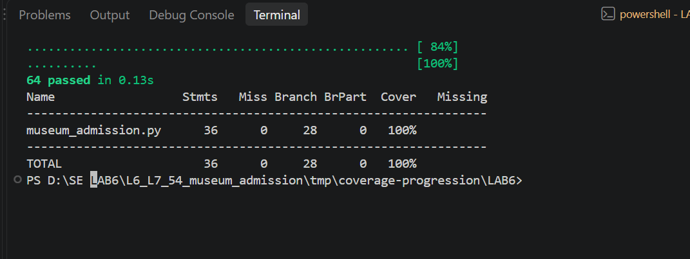

# Lab 6: Branch Coverage Report

**Name:** Manaswi Guntupalli

**Assignment:** 54 - Museum Admission

## Aim

My aim was to check the different decisions in the museum admission program,
including both outcomes of conditions and the important boundary values.
The handout asks for at least 90% branch coverage. My final result is **100%**.

## Starting result

The original two tests covered **10 of 28 branch destinations**. The starting
branch-only coverage was **35.71%**. The terminal's `Cover` column showed **42%**,
because coverage.py combines statements and branch destinations in branch mode.

The exact starting combined result was:

```text
(17 executed statements + 10 covered branch destinations) / (36 + 28)
= 27 / 64
= 42.19%
```

The starting results are saved in [initial_branch.txt](results/initial_branch.txt)
and [initial_branch.json](results/initial_branch.json). I have not added a
screenshot of this low-coverage result.

## Tests added

The separate submission file is
[BranchCoverageTest_54_museum_admission.py](BranchCoverageTest_54_museum_admission.py).
It contains **64 cases** and reaches 100% on its own.

| Test group | Cases | What I checked |
|---|---:|---|
| Ticket decisions | 22 | All four categories, Monday, weekdays, both weekend days, tours, free entry, and age 5 |
| Ticket validation | 5 | Unknown category, negative age, and which error is raised first |
| Invalid group sizes | 4 | Sizes -1 and 0, for school and ordinary groups |
| Discount boundaries | 16 | School groups around size 20; ordinary groups around sizes 8 and 15 |
| Gallery boundaries | 17 | Below/at/above 90%, full and overfull galleries, timed slots, zero capacity, and non-round capacities |
| **Total** | **64** | |

### Ticket prices

I checked valid and invalid categories, negative ages, and the free-entry rule.
A child aged 4 enters free even on a weekend with a tour. A child aged 5 pays.
I checked Monday, Saturday, Sunday, and ordinary weekdays, with and without
tours. Students pay a tour surcharge of 50; other categories pay 100.

For example, an adult with a Monday tour pays `300 // 2 + 100 = 250`.
This checks that the Monday discount is applied before the tour surcharge.
Category validation happens before age validation. An unknown category with
age -1 must therefore raise `unknown category`.

### Group discounts

I checked both school and ordinary groups. School groups below 20 receive 25,
while groups of 20 or more receive 40. Ordinary groups below 8 receive 0,
sizes 8 to 14 receive 10, and sizes 15 or more receive 20.

The tests include sizes 1, 7, 8, 9, 14, 15, 16, 19, 20, and 21 where relevant.
Sizes -1 and 0 must raise an error for both school and ordinary groups.
The returned discount values are checked directly; they are not ticket prices.

### Gallery entry

I checked all three results: `enter`, `queue`, and `wait`. A full gallery returns
`wait` even when the visitor has a timed slot. With capacity 100, 89 visitors
is below the queue threshold, while 90 is exactly at it. At or above 90%,
a timed slot allows entry if space remains.

The compound condition is:

```python
visitors_inside * 10 >= capacity * 9 and not has_timed_slot
```

The tests check a false first condition, a true first condition with a slot,
and a true first condition without a slot. This covers the input combinations
behind the decision, including its short-circuit behaviour.
For capacity 11, 9 visitors may enter but 10 must queue without a slot.
For zero capacity, the existing program returns `wait`.

## Commands used

From the `LAB6` folder:

```powershell
..\.venv\Scripts\python -m coverage run --branch --data-file=.coverage_terminal_branch --source=museum_admission -m pytest -p no:cacheprovider BranchCoverageTest_54_museum_admission.py -q
..\.venv\Scripts\python -m coverage report --data-file=.coverage_terminal_branch -m
```

`--branch` records decision outcomes as well as statements. Only the application
is measured. The separate data filename keeps line and branch results apart.
The cache option avoids a temporary pytest cache warning on this computer.

## Final result

| Item | Result |
|---|---:|
| Tests passed | 64 |
| Executable statements | 36 |
| Missing statements | 0 |
| Branch destinations | 28 |
| Covered branch destinations | 28 |
| Partial branches (`BrPart`) | 0 |
| Missing branch destinations | 0 |
| Branch-only coverage | **100%** |
| Combined statement/branch coverage | **100%** |

Branch-only coverage = 28 / 28 x 100 = **100%**.

Combined coverage = (36 + 28) / (36 + 28) x 100 = **100%**.

### Actual terminal screenshot



This screenshot is from my VS Code terminal. A fresh verification run is also
saved in [final_branch_coverage.txt](results/final_branch_coverage.txt).

## What I understood

Line coverage checks whether a statement ran. Branch coverage goes further
by checking the possible outcomes of decisions. Running a line once does not
mean that all its decision outcomes have been tested.

Function coverage checks whether each function was called. These tests call
all three functions. Path coverage looks at complete combinations of decisions
through the program. This lab measures line and branch coverage, not every
possible path. Coverage.py also does not independently certify condition or
MC/DC coverage.

The final branch file meets the handout's requirement with no missing branch
destinations. The tests check expected prices, discounts, entry decisions, and
errors, so they check results as well as reaching the code.
