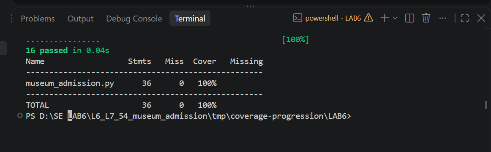

# Lab 6: Code Coverage Report

**Name:** Manaswi Guntupalli

**Assignment:** 54 - Museum Admission

## Aim

My aim was to check how much of the museum admission code runs during testing.
The handout asks for at least 90% code coverage. My final result is **100%**.

## Program and tools

The program has three functions. `ticket_price` calculates the ticket price,
`group_discount` returns the group discount, and `gallery_entry` decides whether
a visitor should enter, queue, or wait. I kept the application code unchanged
and added tests for its existing rules.

I used Python 3.14.0, pytest 9.2.0, coverage 7.17.0, and VS Code.
The required Python packages are listed in `requirements.txt`.

## Starting result

The starter file had two tests: an adult visiting on a weekday and a small
ordinary group. Both passed, but they ran only 17 of the 36 executable
statements. The starting line coverage was **47.22%**, shown as **47%** in
the terminal.

The missing lines were `6, 8, 10, 13, 15, 17-20, 26, 28-30, 32, 34, 39-43`.
These included error handling, free tickets, day-based prices, guided tours,
larger groups, school groups, and gallery entry decisions. Passing the two
starter tests was therefore not enough to check the whole program.

The starting results are saved in [initial_line.txt](results/initial_line.txt)
and [initial_line.json](results/initial_line.json). I have not included screenshots
of results below 90%, as instructed in the handout.

## Tests added

The separate submission file is
[CodeCoverageTest_54_museum_admission.py](CodeCoverageTest_54_museum_admission.py).
It contains **16 cases**. Each row of a parameterized test runs as a separate case.

| Area | Inputs checked | Expected result |
|---|---|---|
| Normal ticket | Adult, age 30, Tuesday, no tour | 300 |
| Monday and student tour | Student, age 20, Monday, tour | 75 + 50 = 125 |
| Weekend and other tour | Senior, age 70, Saturday, tour | 200 + 50 + 100 = 350 |
| Free entry | Child, age 4, Sunday, tour | 0; extras do not apply |
| Age boundary | Child, age 5, Wednesday, no tour | 100 |
| Invalid ticket inputs | Unknown category; negative age | The correct `ValueError` message |
| School groups | Sizes 19 and 20 | Discounts of 25 and 40 |
| Ordinary groups | Sizes 4, 8 and 15 | Discounts of 0, 10 and 20 |
| Invalid group | Size 0 | `ValueError: invalid group size` |
| Gallery decisions | 100, 90 and 50 visitors; capacity 100; no slot | `wait`, `queue`, `enter` |

These cases reach the normal calculations, early returns, error statements,
and each result returned by the three functions.

## Commands used

From the `LAB6` folder, with the virtual environment in the repository root:

```powershell
..\.venv\Scripts\python -m coverage run --data-file=.coverage_terminal_code --source=museum_admission -m pytest -p no:cacheprovider CodeCoverageTest_54_museum_admission.py -q
..\.venv\Scripts\python -m coverage report --data-file=.coverage_terminal_code -m
```

`--source=museum_admission` measures only the application. Test code does not
count towards the result. The report's `-m` option lists missing lines.
The separate data filename keeps this result apart from the branch runs.
The cache option avoids a temporary pytest cache warning on this computer.

## Final result

| Item | Result |
|---|---:|
| Tests passed | 16 |
| Executable statements | 36 |
| Statements executed | 36 |
| Missing statements | 0 |
| Line coverage | **100%** |

Line coverage = executed statements / total executable statements x 100.

Final line coverage = 36 / 36 x 100 = **100%**.

### Actual terminal screenshot



This screenshot is from my VS Code terminal. A fresh verification run is also
saved in [final_code_coverage.txt](results/final_code_coverage.txt). Test timings
can differ between runs without changing the results.

## What I understood

Line coverage tells me whether each executable statement ran at least once.
It does not, by itself, show that both outcomes of every decision were checked.
The calculator example in the handout can run every statement while checking
only the `True` outcomes. That is why I also measured branch coverage.

My final code test file meets the handout's requirement. Covering every line
improves confidence, but does not prove correctness for every possible input.
